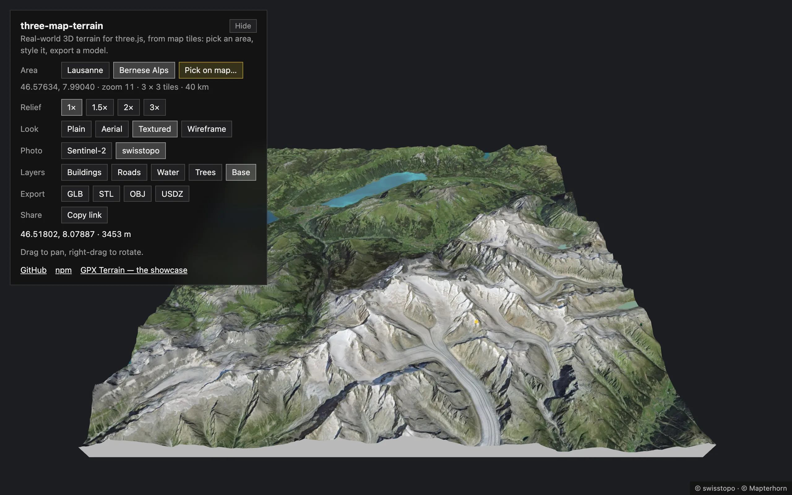
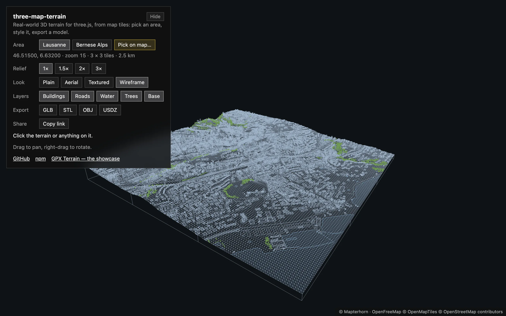
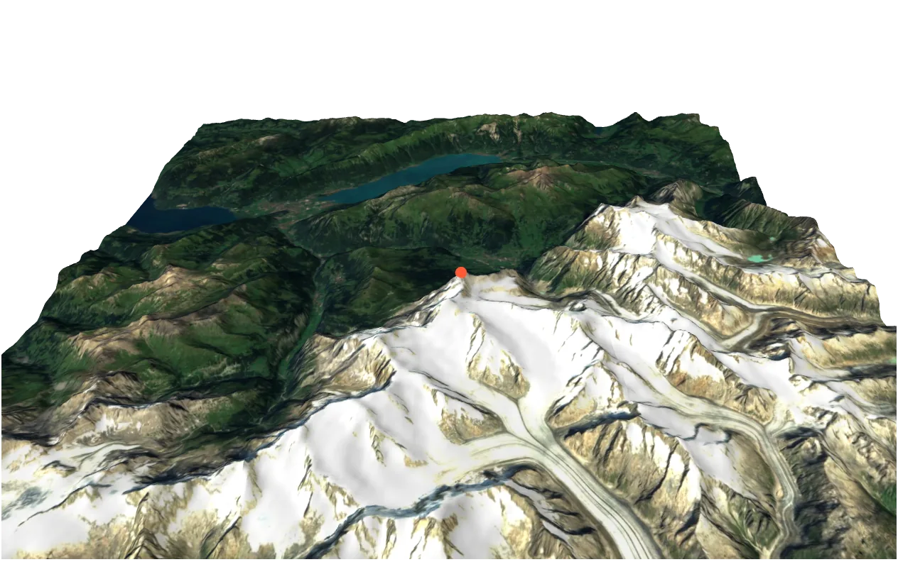
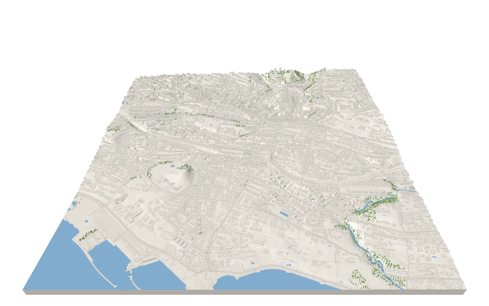
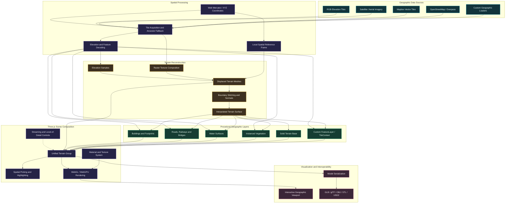
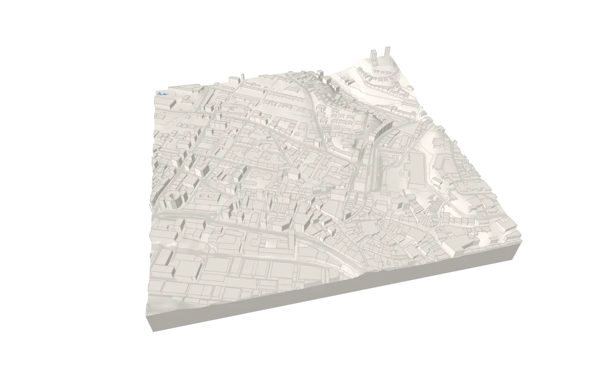

<div align="center">

  <h1>Geospatial Scene Engine</h1>

  <p>
    <strong>The geography of reality, reconstructed in three dimensions.</strong>
  </p>

  <p>
    An extensible geospatial graphics engine for reconstructing real-world
    terrain, generating urban environments, composing spatial data layers,
    and exporting three-dimensional geographic models through TypeScript
    and Three.js.
  </p>

  [](https://www.typescriptlang.org/)
  [](https://threejs.org/)
  [](#rendering-architecture)
  [](https://www.openstreetmap.org/)
  [](https://github.com/4beru/geospatial-scene-engine/actions/workflows/ci.yml)
  [](./LICENSE)

  <p>
    <a href="https://4beru.github.io/geospatial-scene-engine/"><strong>Documentation</strong></a> ·
    <a href="https://4beru.github.io/geospatial-scene-engine/examples/react/">Live Demo</a> ·
    <a href="#geospatial-foundations">Mathematics</a> ·
    <a href="#rendering-architecture">Architecture</a> ·
    <a href="#getting-started">Getting Started</a> ·
    <a href="https://4beru.github.io/geospatial-scene-engine/api/map/">API Reference</a>
  </p>

  <a href="https://4beru.github.io/geospatial-scene-engine/examples/react/?place=alps">
    
  </a>

  <br />

  <sub>
    Digital elevation models · Computational geometry · Geographic reconstruction
  </sub>

</div>

## Overview

Geospatial Scene Engine is a TypeScript library for generating
interactive three-dimensional environments from real-world
geographic information.

The engine transforms digital elevation models, raster imagery,
vector tiles, and geographic features into a unified spatial
scene that can be integrated into Three.js applications.

Rather than treating geographic visualization as a collection
of independent graphical objects, the architecture establishes
a shared terrain surface upon which buildings, transportation
networks, vegetation, water bodies, and custom geographic
features can be reconstructed.

Each stage of the pipeline is configurable: data acquisition,
coordinate transformation, geometry generation, material
composition, spatial interaction, and model serialization.

The project explores the intersection of:

- Geographic Information Systems (GIS).
- Computational geometry and cartographic projections.
- Digital elevation models and terrain reconstruction.
- Procedural urban geometry.
- Spatial data visualization.
- Real-time computer graphics.
- Geographic asset interoperability.

## Visualization

### One Geography, Multiple Perspectives

The same geographic environment can be reconstructed
using different rendering configurations without changing
its underlying spatial data.

<table>
  <tr>
    <td align="center" width="50%">
      <strong>Architectural Model</strong>
    </td>
    <td align="center" width="50%">
      <strong>Textured Environment</strong>
    </td>
  </tr>
  <tr>
    <td>
      <a href="https://4beru.github.io/geospatial-scene-engine/examples/react/?place=lausanne&look=plain">
        
      </a>
    </td>
    <td>
      <a href="https://4beru.github.io/geospatial-scene-engine/examples/react/?place=lausanne&look=textured">
        
      </a>
    </td>
  </tr>
  <tr>
    <td align="center">
      <sub>Urban morphology and volumetric geometry.</sub>
    </td>
    <td align="center">
      <sub>Procedural materials and geographic imagery.</sub>
    </td>
  </tr>
  <tr>
    <td align="center">
      <strong>Aerial Cartography</strong>
    </td>
    <td align="center">
      <strong>Geometric Wireframe</strong>
    </td>
  </tr>
  <tr>
    <td>
      <a href="https://4beru.github.io/geospatial-scene-engine/examples/react/?place=lausanne&look=aerial">
        
      </a>
    </td>
    <td>
      <a href="https://4beru.github.io/geospatial-scene-engine/examples/react/?place=lausanne&look=wireframe">
        
      </a>
    </td>
  </tr>
  <tr>
    <td align="center">
      <sub>Spatial context through aerial photography.</sub>
    </td>
    <td align="center">
      <sub>Underlying triangulation and geometric structure.</sub>
    </td>
  </tr>
</table>

<p align="center">
  <sub>
    Select any visualization to explore its corresponding interactive scene.
  </sub>
</p>

### Terrain and Urban Reconstruction

<table>
  <tr>
    <td align="center" width="50%">
      <strong>Mountainous Terrain</strong>
    </td>
    <td align="center" width="50%">
      <strong>Urban Geography</strong>
    </td>
  </tr>
  <tr>
    <td>
      
    </td>
    <td>
      
    </td>
  </tr>
</table>

From mountainous landscapes to dense urban environments,
the engine uses the same terrain and spatial coordinate
architecture to compose geographic scenes at different scales.

## Features

| Feature | Description |
| :--- | :--- |
| **Terrain Reconstruction** | Generate terrain meshes from digital elevation models. |
| **Raster Imagery** | Apply satellite, aerial, and cartographic textures. |
| **Web Mercator Coordinates** | Bidirectional geographic and local spatial transformations. |
| **Procedural Buildings** | Generate volumetric structures from geographic footprints. |
| **Roads and Railways** | Reconstruct transportation geometry along the terrain surface. |
| **Bridge Generation** | Generate elevated decks and supporting structures. |
| **Water Geometry** | Represent lakes, oceans, rivers, and waterways. |
| **Vegetation** | Generate instanced trees, bushes, and forest regions. |
| **Terrain Bases** | Create solid terrain blocks for dioramas and fabrication workflows. |
| **Custom Layers** | Extend the scene with user-defined geographic features. |
| **Material Customization** | Configure independent materials for terrain and layer components. |
| **Spatial Picking** | Recover geographic positions and identify rendered features. |
| **Tile Streaming** | Dynamically load and remove terrain regions. |
| **Levels of Detail** | Compose terrain maps at different spatial resolutions. |
| **Model Export** | Serialize reconstructed environments into five 3D formats. |
| **WebGL and WebGPU** | Integrate with compatible Three.js rendering backends. |
| **Framework Independence** | Use the engine directly or integrate it into React applications. |

## Geospatial Foundations

The engine connects geographic coordinates, digital elevation
data, and computational geometry through a shared spatial
reference system.

### Web Mercator Tile Coordinates

Geographic information is organized using the conventional
XYZ tile pyramid.

At zoom level $z$, the number of tiles along each axis is:

$$
n=2^z
$$

For longitude $\lambda$ expressed in degrees, the continuous
horizontal tile coordinate is:

$$
x_t=
2^z
\left(
\frac{\lambda}{360}+\frac{1}{2}
\right)
$$

For latitude $\phi$ expressed in radians:

$$
y_t=
\frac{2^z}{2}
\left[
1-
\frac{\ln(\tan\phi+\sec\phi)}{\pi}
\right]
$$

Integer tile indices identify geographic resources, while
fractional coordinates describe positions within individual
tiles.

The projection utilities are implemented in
[`Utils.class.ts`](./src/geo/Utils.class.ts).

### Geographic Scale

The approximate physical width of a tile at latitude
$\phi$ is:

$$
W(\phi,z)=
\frac{C\cos\phi}{2^z}
$$

Where $C$ represents the Earth's equatorial circumference:

$$
C\approx40075016.686\text{ m}
$$

Given a configured tile size $T$ in scene units, the
local scene scale is:

$$
S=\frac{T}{W(\phi,z)}
$$

The engine uses this relationship to coordinate horizontal
scene dimensions with elevation and vertical exaggeration.

Web Mercator remains a projected representation of the Earth.
Physical dimensions are approximate over large regions, and
the generated geometry is not a substitute for survey-grade
geographic data.

### Local Spatial Coordinates

The terrain uses a Z-up coordinate system.

| Axis | Spatial Direction |
| :---: | :--- |
| X | East |
| Y | North |
| Z | Elevation |

The vertical position of a geographic point is calculated as:

$$
Z=(h-h_0)S_z
$$

Where:

| Symbol | Description |
| :---: | :--- |
| $h$ | Geographic elevation in meters. |
| $h_0$ | Configured base altitude. |
| $S_z$ | Vertical scale in scene units per meter. |

When vertical exaggeration is configured:

$$
S_z=E\frac{T}{W(\phi,z)}
$$

Where $E$ is the exaggeration factor.

A value of `1` represents the engine's local true-scale
configuration, while larger values emphasize terrain relief.

## Terrain Reconstruction

### Digital Elevation Models

Terrain geometry is generated from raster elevation data.

Unlike conventional RGB imagery, an elevation tile encodes
numerical height information within its color channels.

The engine includes two elevation decoding schemes.

#### Terrarium Encoding

$$
h=256R+G+\frac{B}{256}-32768
$$

#### Mapbox Terrain RGB

$$
h=0.1(65536R+256G+B)-10000
$$

Where $R$, $G$, and $B$ represent the corresponding
8-bit color channels.

The decoded elevation values are expressed in meters
and stored in floating-point arrays.

Custom decoding functions can also be supplied for
alternative geographic data formats.

### Terrain Mesh Generation

Each geographic tile is represented by a subdivided
`THREE.PlaneGeometry`.

The mesh begins as a regular planar grid. Its vertices
are displaced vertically using the decoded elevation
samples.

For a tile divided into $s$ segments along each axis:

$$
V=(s+1)^2
$$

$$
F=2s^2
$$

Where $V$ represents the number of vertices and $F$
represents the number of triangular faces.

| Configuration | Vertices per Tile | Triangles per Tile |
| :--- | ---: | ---: |
| 32 segments | 1,089 | 2,048 |
| 64 segments | 4,225 | 8,192 |
| 100 segments | 10,201 | 20,000 |
| 256 segments | 66,049 | 131,072 |

The default 3 × 3 terrain grid with 100 segments per
tile contains approximately 180,000 terrain triangles,
before adding geographic layers or additional geometry.

### Tile Continuity

Neighboring elevation tiles may contain different
height samples along their shared boundaries.

The engine reconciles neighboring edges and refreshes
the affected vertex normals to maintain terrain continuity.

This reduces visible discontinuities between adjacent
terrain meshes.

When elevation data is unavailable at a requested zoom
level, the engine can retrieve an ancestor tile,
extract the corresponding region, and resample it
for the requested tile.

This preserves geographic coverage without inventing
additional source elevation detail.

## Rendering Architecture

The engine separates geographic data acquisition,
spatial transformation, terrain construction,
feature generation, and scene serialization.



The diagram describes the conceptual data flow between
the engine's major computational components.

The terrain surface provides a shared geometric reference
for the layers, ensuring that independently generated
features remain spatially coordinated.

### Core Architectural Components

| Component | Responsibility |
| :--- | :--- |
| `Map` | Terrain lifecycle, geographic transformations, layers, and export. |
| `Tile` | Elevation decoding, terrain geometry, imagery, and surface interpolation. |
| `Source` | Raster imagery acquisition and configuration. |
| `ElevationSource` | Elevation acquisition and numerical decoding. |
| `VectorTiles` | Shared vector tile loading and feature decoding. |
| `FeatureLayer` | Geographic feature lifecycle and procedural geometry generation. |
| `TileContext` | Spatial operations for constructing custom terrain-aligned geometry. |
| `Utils` | Web Mercator transformations and tile addressing. |


## Extensible Spatial Architecture

The engine is not limited to its built-in geographic layers.

The `FeatureLayer` abstraction provides a framework for
introducing custom spatial information and procedural
geometry into the terrain.

<div align="center">

  

  <br />

  <sub>
    Custom spatial layer representing mountain summits
    positioned on the reconstructed terrain surface.
  </sub>

</div>

A custom layer can define its own feature schema,
data loader, geometry-generation logic, and materials.

### Tile Context

The `TileContext` interface provides reusable
computational geometry operations.

| Operation | Responsibility |
| :--- | :--- |
| `toLocal()` | Transform geographic positions into tile-local coordinates. |
| `groundAt()` | Evaluate the rendered terrain height at a local position. |
| `drapePolygon()` | Adapt polygon geometry to the terrain surface. |
| `drapeLine()` | Construct terrain-aligned ribbons. |
| `drapePath()` | Construct paths following the terrain. |
| `extrude()` | Generate volumetric geometry from polygonal footprints. |
| `face()` | Generate planar polygonal surfaces. |
| `segment()` | Construct spatial line segments. |
| `instances()` | Generate repeated geometry through instanced rendering. |
| `feature()` | Associate generated geometry with selectable feature metadata. |

These primitives can be combined to visualize
domain-specific spatial datasets without modifying
the core terrain implementation.

Potential use cases include:

- Scientific observation points.
- Geographic infrastructure.
- Environmental measurements.
- Architectural models.
- Terrain annotations.
- Custom spatial datasets.

[Custom layer development guide](https://4beru.github.io/geospatial-scene-engine/own-layers/)

## Geographic Data Sources

The engine separates imagery, elevation, and geographic
feature acquisition into independently configurable
data sources.

### Elevation Sources

| Provider | Encoding |
| :--- | :--- |
| AWS Terrain Tiles | Terrarium |
| Mapterhorn | Terrarium |
| Mapbox Terrain RGB | Mapbox RGB |
| MapTiler Terrain RGB | Mapbox RGB |
| Custom Elevation Source | Configurable decoder |

### Imagery Sources

| Provider | Representation |
| :--- | :--- |
| Sentinel-2 / EOX | Satellite imagery |
| OpenStreetMap | Raster cartography |
| Mapbox | Satellite imagery |
| MapTiler | Satellite imagery |
| Custom XYZ Provider | Configurable raster imagery |
| No Imagery | Material-based terrain rendering |

### Vector and Feature Sources

| Source | Data Representation |
| :--- | :--- |
| OpenFreeMap | OpenMapTiles vector schema |
| VersaTiles | Shortbread vector schema |
| MapTiler | OpenMapTiles vector schema |
| Mapbox Streets | Mapbox vector schema |
| Protomaps | Protomaps basemap schema |
| Overpass | OpenStreetMap geographic features |
| Overture Maps | Custom source integration |
| Custom Loader | User-defined geographic feature data |

Source adapters support URL templates, TileJSON,
custom loading functions, attribution metadata,
and source-specific zoom constraints.

Mapbox, MapTiler, Protomaps, and other providers
may require authentication credentials.

Data availability, geographic coverage, licensing,
and permitted usage remain provider-dependent.

[Complete data source documentation](https://4beru.github.io/geospatial-scene-engine/sources/)

## Materials and Visual Composition

Geographic geometry and its visual representation
are treated as separate architectural concerns.

<div align="center">

  

</div>

The material system supports configurable visual
representations across individual geographic layers.

| Scene Component | Material Configuration |
| :--- | :--- |
| Terrain | Raster imagery, color, lighting, and custom materials. |
| Buildings | Independent wall, roof, floor, and edge materials. |
| Roads | Surface materials, markings, and bridge structure materials. |
| Water | Configurable surface appearance. |
| Vegetation | Independent trunk, crown, and bush materials. |
| Terrain Base | Side and bottom materials. |
| Custom Layers | Materials assigned to user-defined geometry parts. |

The rendering pipeline also supports imagery processing
before texture creation.

This enables visual configurations such as grayscale
cartography, custom color treatments, architectural
diagrams, and technical wireframe representations.

UV coordinates expressed in meters are available
for supported procedural geometry components,
allowing textures to follow geographic scale.

[Material system documentation](https://4beru.github.io/geospatial-scene-engine/materials/)

## Spatial Interaction

### Geographic Positioning

Objects can be positioned at a geographic coordinate
and explicit altitude.

```typescript
const position = map.getPosition({
  lat: 46.5191,
  lon: 6.6323,
  alt: 450,
});

object.position.set(
  position.x,
  position.y,
  position.z
);
```

Alternatively, objects can be placed directly on
the reconstructed terrain surface.

```typescript
const ground = await map.getTerrainPosition({
  lat: 46.5191,
  lon: 6.6323,
});

object.position.set(
  ground.x,
  ground.y,
  ground.z
);
```

A synchronous variant is available for continuously
updated objects when the relevant terrain tile has
already been loaded.

### Geographic Picking

The engine supports selecting terrain positions
through a Three.js raycaster.

```typescript
raycaster.setFromCamera(pointer, camera);

const intersection = map.pick(raycaster);

if (intersection) {
  console.log({
    latitude: intersection.lat,
    longitude: intersection.lon,
    altitude: intersection.alt,
  });
}
```

Geographic layers can also expose feature-level
picking and visual highlighting.

```typescript
const hit = buildings.pick(raycaster);

buildings.highlight(hit?.feature);
```

The underlying raycasting implementation exploits
the regular terrain grid to inspect relevant triangles
rather than testing the entire terrain mesh indiscriminately.

This connects rendered geometry with its associated
geographic position and feature metadata.

## Large-Scale Terrain Rendering

Rendering large geographic environments requires balancing
spatial coverage, numerical detail, network activity,
GPU resources, and geometry complexity.

The engine provides explicit controls for managing
these trade-offs.

### Terrain Streaming

Terrain tiles can be loaded and removed dynamically.

```typescript
await map.addTileSegment(tileX, tileY);

map.removeTileSegment(tileX, tileY);
```

When a tile is removed, its associated resources
and layer geometry are released through the
terrain lifecycle.

Applications can implement their own streaming
policies based on:

- Camera position.
- Geographic location.
- Visible spatial extent.
- Navigation targets.
- Available rendering resources.

The engine provides the streaming primitives.
It does not automatically implement an unlimited
world or globe-streaming policy.

### Levels of Detail

Multiple terrain maps at different zoom levels
can be aligned within the same spatial reference.

```typescript
coarseTerrain.alignTo(detailedTerrain);
```

This allows applications to construct a detailed
central region surrounded by lower-resolution
terrain.

The `skirt` option generates downward geometry
along tile boundaries to conceal visible gaps
between terrain resolutions.

These skirts are visual continuity mechanisms
and are excluded from geographic picking
and model export.

### Imagery Resolution

Terrain resolution and raster texture resolution
can be configured independently.

The `imageryZoomOffset` option determines how
many higher-resolution imagery tiles are combined
into one terrain texture.

For an imagery offset $k$:

$$
N_{imagery}=4^k
$$

| Imagery Offset | Images per Terrain Tile |
| :---: | ---: |
| 0 | 1 |
| 1 | 4 |
| 2 | 16 |
| 3 | 64 |

Increasing imagery resolution can improve visual
detail while increasing request volume and texture
memory consumption.

### Performance Strategies

The architecture incorporates several techniques
for managing computational workload:

| Technique | Purpose |
| :--- | :--- |
| Shared Vector Tiles | Avoid repeated loading and decoding across layers. |
| Layer Scheduling | Distribute feature construction across frames. |
| Focus-Based Prioritization | Process tiles closer to the active spatial focus first. |
| Instanced Geometry | Reduce repeated geometry and draw-call overhead. |
| Partial Normal Updates | Recalculate normals only around affected terrain regions. |
| Grid-Based Raycasting | Restrict intersection tests to relevant terrain triangles. |
| Distance-Based Visibility | Hide selected layer components beyond configured distances. |
| Resource Disposal | Release geometry, textures, and requests when tiles are removed. |

The actual performance of a geographic scene depends
on terrain resolution, layer density, imagery detail,
data sources, graphics hardware, and application policy.

[Large-area rendering guide](https://4beru.github.io/geospatial-scene-engine/large-areas/) ·
[Performance documentation](https://4beru.github.io/geospatial-scene-engine/performance/)
## Technology Stack

<div align="center">

  

</div>

| Technology | Responsibility |
| :--- | :--- |
| **TypeScript** | Typed public API, spatial algorithms, and engine architecture. |
| **Three.js** | Terrain meshes, procedural geometry, materials, and rendering. |
| **WebGL / WebGPU** | Compatible graphics execution backends. |
| **React Three Fiber** | Declarative integration with Three.js. |
| **React** | Interactive geographic demonstration application. |
| **OpenLayers** | Geographic region selection in the React example. |
| **Mapbox Vector Tiles** | Compact geographic feature representation. |
| **PMTiles** | Geographic archive access in the custom Overture example. |
| **Vite** | Library compilation and interactive development. |
| **Astro Starlight** | Technical documentation and embedded demonstrations. |
| **pnpm** | Monorepo dependency and workspace management. |
| **Vitest** | Computational and architectural unit testing. |
| **Playwright** | Browser-based rendering verification. |
| **GitHub Actions** | Automated validation and documentation deployment. |

The core library declares Three.js as a peer dependency
and does not require additional runtime package dependencies.

The examples and documentation maintain their own
workspace-specific dependencies.

## Getting Started

### Requirements

- Node.js 24.
- pnpm 12.4.2, as pinned in `package.json`.
- Git.
- A modern browser with WebGL support.
- WebGPU support when using the WebGPU renderer.
- Access to the configured geographic data sources.

Three.js is declared as a peer dependency with
a minimum version of `0.152.0`.

The current development workspace uses Three.js `0.186.x`.

### Clone the Repository

```bash
git clone https://github.com/4beru/geospatial-scene-engine.git

cd geospatial-scene-engine
```

### Install Dependencies

```bash
pnpm install --frozen-lockfile
```

The repository uses a shared pnpm workspace for
the core library, documentation, and demonstration
applications.

### Build the Library

```bash
pnpm build
```

The compiled library and TypeScript declarations
are generated in:

```text
dist/
```

### Start the Playground

```bash
pnpm dev
```

Open:

```text
http://localhost:5173
```

### Run the React Example

```bash
pnpm --dir examples/react dev
```

### Run the Basic Example

```bash
pnpm --dir examples/basic dev
```

Each application uses its configured local
development server.

### Run the Documentation

```bash
pnpm --dir docs dev
```

Open:

```text
http://localhost:4321/geospatial-scene-engine/
```

> [!IMPORTANT]
> This repository is not a separately published npm package.
>
> The internal package identifier remains `three-map-terrain`
> for compatibility with the existing implementation.
>
> Installing that package directly from npm retrieves
> the upstream library, not this repository's checkout.
>
> The local examples and documentation resolve the root
> library through pnpm's `workspace:*` protocol.
> Rebuild the library after modifying its source.

## Quick Start

The engine integrates directly into a Three.js scene.

The following example creates a geographic terrain with
real elevation and configures a locally scaled urban
environment.

```typescript
import {
  AmbientLight,
  DirectionalLight,
  PerspectiveCamera,
  Scene,
  WebGLRenderer,
} from 'three';

import { MapControls } from
  'three/addons/controls/MapControls.js';

import {
  Map as TerrainMap,
  Buildings,
  Roads,
} from 'three-map-terrain';

const scene = new Scene();

const camera = new PerspectiveCamera(
  55,
  window.innerWidth / window.innerHeight,
  1,
  100_000
);

camera.up.set(0, 0, 1);
camera.position.set(0, -1400, 1100);

const renderer = new WebGLRenderer({
  antialias: true,
});

renderer.setSize(
  window.innerWidth,
  window.innerHeight
);

document.body.appendChild(renderer.domElement);

const controls = new MapControls(
  camera,
  renderer.domElement
);

scene.add(new AmbientLight(0xffffff, 1.5));

const sunlight = new DirectionalLight(0xffffff, 2);

sunlight.position.set(-1500, 2000, 3000);

scene.add(sunlight);

const map = new TerrainMap({
  location: {
    lat: 46.5191,
    lon: 6.6323,
  },
  elevation: {
    api: 'aws',
  },
  options: {
    zoom: 15,
    nTiles: 3,
    tileSegments: 64,
    exaggeration: 1,
  },
  material: {
    color: '#e8e4da',
  },
});

map.addLayer(
  new Buildings({
    source: { api: 'openfreemap' },
    edges: true,
  })
);

map.addLayer(
  new Roads({
    source: { api: 'openfreemap' },
  })
);

map.focus = controls.target;

scene.add(map.terrain);

await map.init();

renderer.setAnimationLoop(() => {
  controls.update();
  renderer.render(scene, camera);
});

console.log(map.attributions);
```

The application defines the Three.js scene,
camera, lighting, and rendering lifecycle,
while the geospatial engine manages terrain
and geographic layer reconstruction.

In a complete application, display the geographic
attributions within the user interface.

Use `map.whenReady()` when an operation requires
all terrain textures and layer geometry to finish
loading.

Call `map.clean()` when disposing of the geographic
environment.

## Public API

### Terrain Management

| Method | Responsibility |
| :--- | :--- |
| `init()` | Initialize the configured terrain grid. |
| `whenReady()` | Wait for terrain, imagery, and geographic layers. |
| `clean()` | Release terrain resources and abort pending operations. |
| `addLayer()` | Register a geographic layer. |
| `removeLayer()` | Remove an existing layer and its resources. |
| `setSource()` | Replace the terrain imagery source. |
| `setMaterial()` | Update terrain material configuration. |
| `addTileSegment()` | Dynamically load a terrain tile. |
| `removeTileSegment()` | Remove a terrain tile. |
| `alignTo()` | Align terrain coordinate systems. |
| `export()` | Serialize the geographic environment. |

### Spatial Operations

| Method | Responsibility |
| :--- | :--- |
| `getPosition()` | Convert geographic coordinates and altitude into scene coordinates. |
| `getTerrainPosition()` | Evaluate a geographic position on the rendered surface. |
| `getTerrainPositionSync()` | Evaluate terrain position for an already loaded tile. |
| `getLocation()` | Convert local scene coordinates into geographic coordinates. |
| `pick()` | Recover the geographic location intersected by a ray. |

### Default Terrain Configuration

| Option | Default |
| :--- | ---: |
| `nTiles` | 3 |
| `zoom` | 11 |
| `tileSize` | 600 |
| `tileSegments` | 100 |
| `zScale` | 0.045 |
| `baseAltitude` | 0 |
| `imageryZoomOffset` | 1 |
| `skirt` | 0 |

A custom rectangular tile grid can be supplied through
the `grid` option.

---

<div align="center">

  <h3>Where geography becomes geometry.</h3>

  <p>
    Part of <strong>Geospatial Graphics</strong> — a collection
    of projects exploring geographic information, computational
    geometry, spatial visualization, and the digital reconstruction
    of real-world environments.
  </p>

  <p>
    <sub>Curated by Abel Ortega.</sub>
  </p>

  <a href="https://github.com/4beru">GitHub</a> ·
  <a href="https://www.aberu.site">Portfolio</a>

</div>
